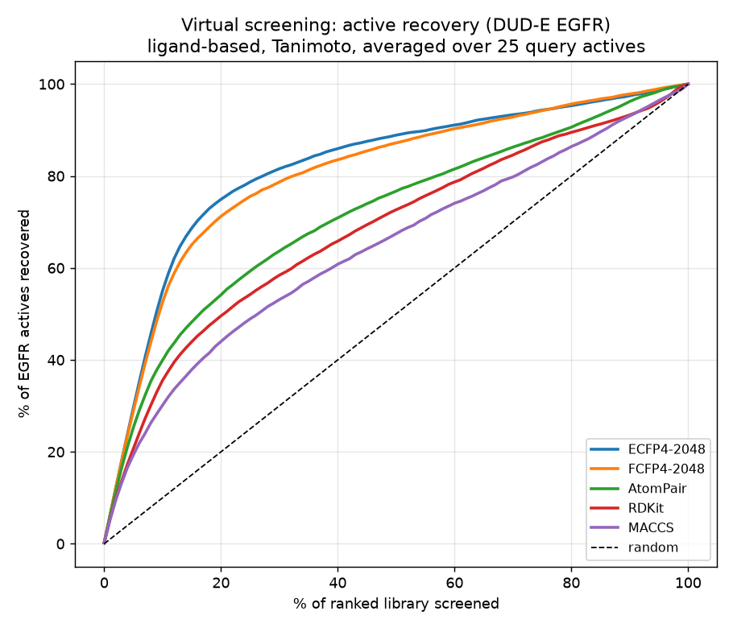
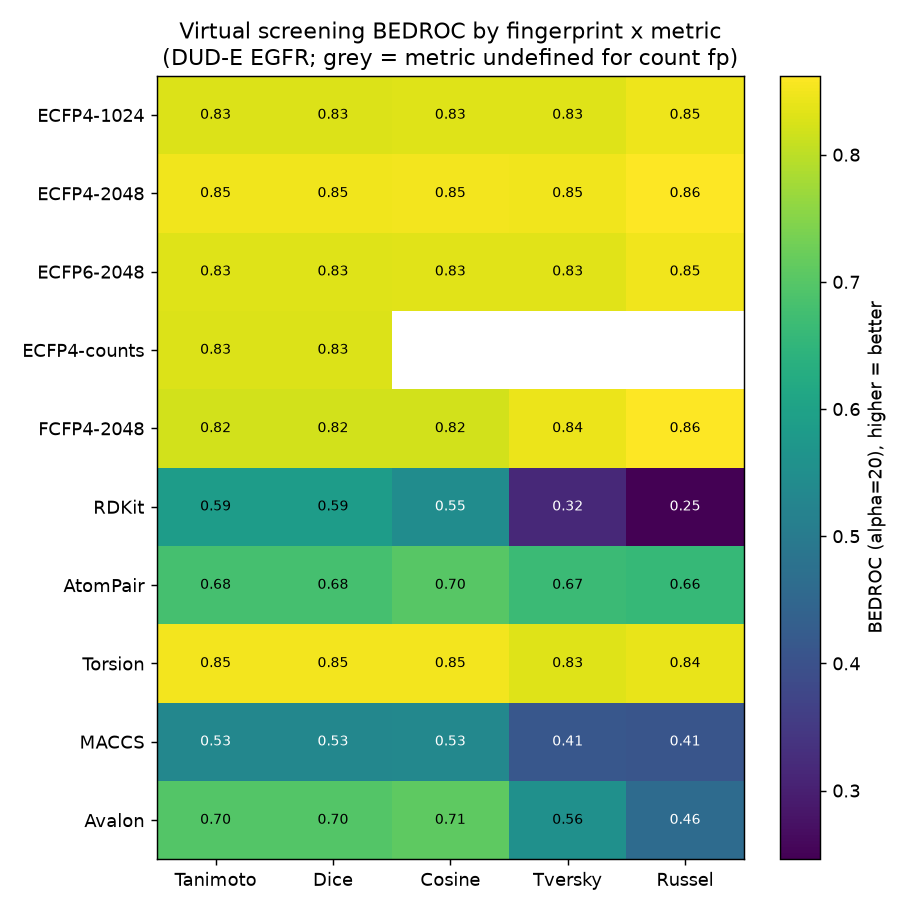

# Fingerprint & Similarity Guide

**Which molecular fingerprint and which similarity metric should you actually use? A 12-notebook course that answers it with real benchmarks instead of habit — all runnable in your browser on Google Colab.**

[](https://github.com/hentablihamza/fingerprint-similarity-guide/actions/workflows/ci.yml)
[](https://www.python.org)
[](https://colab.research.google.com/github/hentablihamza/fingerprint-similarity-guide/blob/main/notebooks/01_what_is_a_fingerprint.ipynb)

## The problem

Almost everyone in cheminformatics reaches for **ECFP4 + Tanimoto** by reflex. Sometimes that is exactly right. Often it is not — and nobody shows you the numbers. Pick the wrong fingerprint for scaffold hopping and you will never find a new chemotype; use a symmetric metric for a substructure query and you will miss the molecules that contain your scaffold; feed binary fingerprints to a solubility model that needed counts and you leave accuracy on the table.

This repo settles those choices with **four real benchmarks**, every number computed from executed code on public data (DUD-E EGFR, ChEMBL EGFR inhibitors, Delaney ESOL). Nothing here is quoted or invented — run [`scripts/run_benchmarks.py`](scripts/run_benchmarks.py) and you get the same tables.



*From Notebook 04: on DUD-E EGFR, ECFP4/FCFP recover actives far earlier than MACCS or RDKit-path fingerprints — but as Notebook 05 shows, that specificity is exactly why they hop scaffolds worse.*

## What the benchmarks actually show

| Task | Winner (fingerprint + metric) | Real result | Loser / trap |
|------|-------------------------------|-------------|--------------|
| **Virtual screening** (DUD-E EGFR) | **ECFP4-2048 / Torsion + Tanimoto** | BEDROC **0.85**, EF1% **6.2** | MACCS + Tanimoto BEDROC **0.53** |
| **Scaffold hopping** (cross-scaffold similarity retention) | **FCFP / AtomPair / RDKit** | FCFP retention **0.47** > ECFP4 **0.41** > ECFP6 **0.36** | exact **ECFP6 is the worst hopper** |
| **Substructure / containment** | **ECFP4 + Tversky (α=1, β=0)** | ranks true SMARTS matches far above Tanimoto | symmetric Tanimoto hides contained scaffolds |
| **Nearest-neighbour QSAR** (ESOL logS) | **ECFP4-counts + Tanimoto** | R² **0.77** (counts) vs **0.65** (binary) | **Russel-Rao → R² −0.17** (worse than the mean) |
| **Activity cliffs** (ChEMBL EGFR) | **ECFP6** (most specific) | flags only **1,028** near-neighbour pairs | **MACCS invents 80,604** and an 18% "cliff" rate |

The single idea behind the whole table: **specific** fingerprints (ECFP, counts, 2048-bit) win screening, QSAR, clustering and cliff-awareness; **tolerant** fingerprints (FCFP features, atom pairs, RDKit paths, MACCS keys) win scaffold hopping but blur everything else. Metric-wise, **Tanimoto/Dice/Cosine** are safe and near-interchangeable for good fingerprints, **Tversky** is a specialist for directional queries, and **Russel-Rao** is a trap for prediction.

## Who this is for

- **Ph.D. / master's students and researchers** entering computational drug discovery.
- **Medicinal and computational chemists** choosing a similarity method for screening, SAR, or library design.
- **Programmers** in cheminformatics who want a benchmark-grounded tour of RDKit fingerprints and metrics.

You need only basic Python; the chemistry and the stats are taught as they appear.

## Syllabus

Click a badge to open a notebook in Colab, or browse [`notebooks/`](notebooks).

| # | Notebook | You will learn to… | Colab |
|---|----------|--------------------|-------|
| 01 | What a fingerprint is | bits, folding, collisions, count vs binary | [](https://colab.research.google.com/github/hentablihamza/fingerprint-similarity-guide/blob/main/notebooks/01_what_is_a_fingerprint.ipynb) |
| 02 | The fingerprint zoo | generate ECFP/FCFP/RDKit/atom-pair/torsion/MACCS/Avalon | [](https://colab.research.google.com/github/hentablihamza/fingerprint-similarity-guide/blob/main/notebooks/02_fingerprint_zoo.ipynb) |
| 03 | Similarity metrics | Tanimoto vs Dice vs Cosine vs Tversky, worked math, why not Euclidean | [](https://colab.research.google.com/github/hentablihamza/fingerprint-similarity-guide/blob/main/notebooks/03_similarity_metrics.ipynb) |
| 04 | Benchmark 1 · Virtual screening | EF1%/EF5%, BEDROC, ROC-AUC on DUD-E EGFR | [](https://colab.research.google.com/github/hentablihamza/fingerprint-similarity-guide/blob/main/notebooks/04_benchmark_virtual_screening.ipynb) |
| 05 | Benchmark 2 · Scaffold hopping | cross-scaffold recovery and similarity retention | [](https://colab.research.google.com/github/hentablihamza/fingerprint-similarity-guide/blob/main/notebooks/05_benchmark_scaffold_hopping.ipynb) |
| 06 | Benchmark 3 · Activity cliffs | SALI, cliff rate per fingerprint | [](https://colab.research.google.com/github/hentablihamza/fingerprint-similarity-guide/blob/main/notebooks/06_benchmark_activity_cliffs.ipynb) |
| 07 | Benchmark 4 · Nearest-neighbour QSAR | k-NN regression on ESOL, fp × metric grid | [](https://colab.research.google.com/github/hentablihamza/fingerprint-similarity-guide/blob/main/notebooks/07_benchmark_knn_qsar.ipynb) |
| 08 | Size, folding & counts | 1024 vs 2048, collisions, count vs binary | [](https://colab.research.google.com/github/hentablihamza/fingerprint-similarity-guide/blob/main/notebooks/08_size_and_folding.ipynb) |
| 09 | Tversky & substructure search | asymmetric similarity, containment, SMARTS pre-filter | [](https://colab.research.google.com/github/hentablihamza/fingerprint-similarity-guide/blob/main/notebooks/09_tversky_substructure.ipynb) |
| 10 | Clustering & diversity | Butina clusters, MaxMin picks, fp dependence | [](https://colab.research.google.com/github/hentablihamza/fingerprint-similarity-guide/blob/main/notebooks/10_clustering_diversity.ipynb) |
| 11 | Speed & scale | bulk similarity, popcounts, FPSim2 (optional) | [](https://colab.research.google.com/github/hentablihamza/fingerprint-similarity-guide/blob/main/notebooks/11_speed_and_scale.ipynb) |
| 12 | The decision guide | a cheat sheet: task → fingerprint + metric | [](https://colab.research.google.com/github/hentablihamza/fingerprint-similarity-guide/blob/main/notebooks/12_decision_guide.ipynb) |

Each notebook has clear **learning objectives**, Markdown explanations, runnable code, and **exercises with collapsible solutions**. Work them in order — later notebooks reuse the fingerprints, metrics, and data of earlier ones.



*From Notebook 04: BEDROC for every fingerprint × metric. Metric choice is fingerprint-dependent — Russel-Rao helps ECFP slightly but wrecks RDKit-path fingerprints.*

## How to use it

### Option 1 — Google Colab (nothing to install)

Click any **Open in Colab** badge. The first cell installs dependencies and clones this repo so the cached data and the shared `fsg` helper are available.

### Option 2 — Run locally

```bash
git clone https://github.com/hentablihamza/fingerprint-similarity-guide.git
cd fingerprint-similarity-guide

# with conda
conda env create -f environment.yml
conda activate fingerprint-similarity-guide

# or with pip
pip install -r requirements.txt

jupyter notebook   # open the notebooks/ folder
```

Every notebook runs **offline** from the cached data in [`data/`](data) — no network needed. Reproduce the benchmark tables and figures with:

```bash
python scripts/run_benchmarks.py   # writes docs/benchmark_results.json
python scripts/make_figures.py     # writes the docs/*.png figures
```

## Datasets

All data are small, public, and committed under [`data/`](data) with full provenance in [`data/README.md`](data/README.md) and [`data/provenance.json`](data/provenance.json):

- **DUD-E EGFR** — 542 actives + 3,000 property-matched decoys (subsampled from 35,050), for virtual screening and scaffold hopping.
- **ChEMBL EGFR inhibitors** — 6,871 compounds with pIC50 (ChEMBL 37, target CHEMBL203), for activity cliffs.
- **Delaney ESOL** — 1,128 compounds with aqueous solubility (logS), for nearest-neighbour QSAR.

No results are invented. DUD-E is provided free by the Irwin and Shoichet Laboratories (UCSF); ChEMBL data are used under CC BY-SA 3.0; see [`data/README.md`](data/README.md) for full citations.

## Related open-source tools

Part of a small cheminformatics ecosystem you can use on your own projects:

- **[practical-cheminformatics-course](https://github.com/hentablihamza/practical-cheminformatics-course)** — from Python basics to QSAR and virtual screening.
- **[chembl-easy](https://github.com/hentablihamza/chembl-easy)** — one-command clean, ML-ready ChEMBL downloads.
- **[qsar-split-bench](https://github.com/hentablihamza/qsar-split-bench)** — benchmark random, scaffold, cluster, and time splits.
- **[docking-made-easy](https://github.com/hentablihamza/docking-made-easy)** — AutoDock Vina docking with protein prep and box from a co-crystal ligand.
- **[practical-biopython-course](https://github.com/hentablihamza/practical-biopython-course)** — sequences, structures, and bioinformatics with Biopython.
- **[practical-molecular-dynamics-course](https://github.com/hentablihamza/practical-molecular-dynamics-course)** — MD step by step with OpenMM.

## Author

**Hamza Hentabli, Ph.D.** — AI/ML drug discovery & cheminformatics scientist, and former teacher who has mentored Ph.D. and master's students. This guide distills real method-selection decisions into material anyone can run and verify.

- GitHub: [@hentablihamza](https://github.com/hentablihamza)
- Google Scholar: [publications](https://scholar.google.com/citations?user=-7dUlnMAAAAJ)
- ORCID: [0000-0002-9530-2815](https://orcid.org/0000-0002-9530-2815)

If these materials help your work or teaching, please cite them (see [`CITATION.cff`](CITATION.cff)). Issues and suggestions are welcome.
